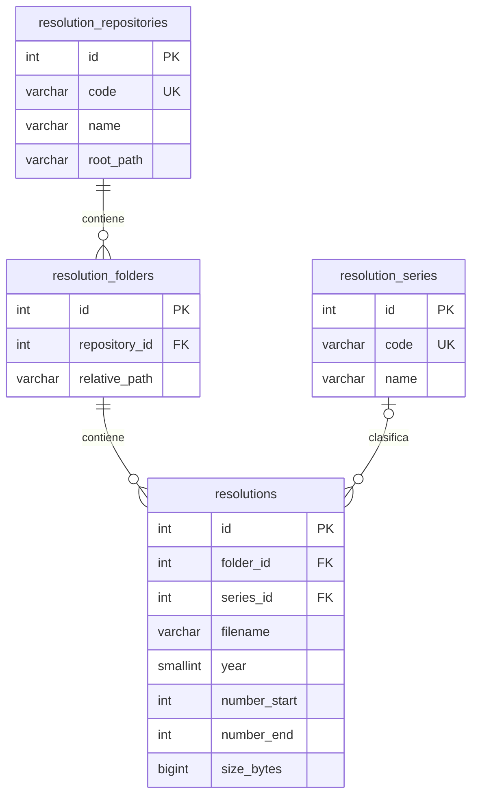

# Repositorio de Resoluciones

Sección del sistema: `/resoluciones`. Acceso para el administrador y los usuarios con el módulo `resoluciones` asignado desde Gestión de Usuarios. Aplica tanto al catálogo como a la vista previa, descarga, carga y corrección de identificadores.

## Archivos y búsqueda

El archivo institucional se consulta desde `RESOLUTIONS_ARCHIVE_ROOT`, configurado solo por el administrador del servidor. Los PDF permanecen en su ubicación original: la indexación lee nombres, carpetas y tamaños, sin OCR, extracción de texto, hashes de contenido ni copia masiva. La unidad debe estar disponible para abrirlos.

Los PDF nuevos cargados por la interfaz se guardan en `storage/app/resoluciones`, fuera de la carpeta pública. Los archivos se entregan por una ruta autenticada que comprueba la ubicación real y evita salir del repositorio. La vista previa utiliza PDF.js dentro de un diálogo, con navegación por páginas y zoom. Se dibuja únicamente la página consultada y se solicitan datos por rangos cuando el servidor lo admite. Se ofrecen descarga y apertura en otra pestaña como alternativas.

La búsqueda por palabras conserva el nombre completo original y tolera mayúsculas y acentos en MySQL. Cada palabra se combina con las demás. Año, número y serie son filtros opcionales. El número encuentra tanto una resolución individual como un PDF cuyo rango la incluye. Se muestran 30 resultados por página.

| Nombre | Identificación propuesta |
|---|---|
| `RDR-001.pdf`, carpeta `RDR DRE HCO 2000` | RDR, número 1, año 2000 |
| `RDR Nº 1000 - 2006.pdf` | RDR, número 1000, año 2006 |
| `00003 - 00053 RDR 2006.pdf` | RDR, rango 3–53, año 2006 |
| `0001 RDR 2024 DESIGNAR…pdf` | RDR, número 1, año 2024; nombre completo buscable |
| `0001 RDR 2021 … RDUGEL 0408 2020.pdf` | El identificador principal es 1/2021; la referencia 0408/2020 no lo reemplaza |
| `RDR - (1).pdf` | Nombre ambiguo: se conserva y queda por revisar |

La interfaz permite corregir serie, año y número/rango después de revisar el documento. Esto no renombra ni modifica el PDF. Reindexar conserva esas correcciones. Un archivo que deja de estar disponible devuelve 404, sin borrar automáticamente su registro.

## Modelo en tercera forma normal (3FN)



Cada fila de `resolutions` representa un archivo físico del repositorio, que puede contener una resolución o un rango. Los números/años por sí solos no se declaran únicos: los originales pueden contener variantes y más de una serie. `number_end` es nulo para archivos individuales; los identificadores no reconocidos también se guardan como nulos.

La raíz del repositorio se guarda una sola vez. La ruta relativa de cada carpeta se guarda una sola vez por repositorio. Las resoluciones referencian la carpeta y la serie mediante claves foráneas. Los nombres de las series y la raíz no se repiten en cada documento. Los atributos dependen de las claves de sus respectivas tablas; no se almacenan totales, etiquetas derivadas de revisión ni texto duplicado del nombre.

Índices:

- Único en `resolution_repositories.code` y en `resolution_series.code`.
- Único en `(repository_id, relative_path)`.
- Único en `(folder_id, filename)`, para registrar repetidamente el mismo directorio sin duplicar filas.
- Índice en `(year, number_start)`, además de los índices para las claves foráneas.

Las rutas y nombres usan identidad binaria en MySQL para distinguir archivos diferentes por sus acentos. La búsqueda usa explícitamente una comparación insensible a acentos y mayúsculas. No hay BLOB, base64, imágenes, OCR, una fila por página ni un índice de texto completo. El tamaño depende de los nombres y de las filas, no de los gigabytes de PDF.

## Operación

```powershell
php artisan resoluciones:indexar
```

Se ejecuta únicamente cuando se decide incorporar o actualizar los nombres del archivo institucional. Lee la raíz configurada en `.env`, procesa en bloques de 500 y usa un bloqueo para evitar ejecuciones simultáneas. No elimina archivos ni registros ausentes. `--limit=100` permite una primera comprobación.

La carga por navegador admite PDF o carpetas sin límite de cantidad por lote, con un máximo compartido de cinco transferencias simultáneas y hasta 100 MB por archivo. El usuario puede minimizar, navegar por la web, crear lotes independientes, pausar y reintentar errores. La carpeta y el nombre repetidos se omiten sin sobrescribir. El año del lote es opcional y se aplica a los archivos nuevos seleccionados. Los límites PHP configurados deben permitir la carga (`upload_max_filesize=100M`, `post_max_size=110M`).

Para alojar esto en otro servidor hay que transferir los PDF y configurar una raíz accesible allí; una ruta `D:` solo existe en este equipo. GitHub contiene únicamente código, pruebas y documentación: no incluye PDF, bases de datos, respaldos ni credenciales. Publicar la rama no instala el módulo en producción.

### Instalación del módulo en otro entorno

Respaldar primero la base del entorno y revisar el código antes de desplegar. Las dos migraciones del módulo crean las tablas del archivo y ajustan su comparación de nombres; no modifican tablas de Planillas, usuarios ni roles. Para evitar ejecutar migraciones pendientes de otros módulos, ejecutar exclusivamente estas rutas durante un despliegue autorizado:

```sh
php artisan migrate --path=database/migrations/2026_10_22_000001_create_resolution_archive_tables.php --force
php artisan migrate --path=database/migrations/2026_10_22_000002_preserve_resolution_filename_identity.php --force
npm ci
npm run build
```

El directorio `storage/app/resoluciones` debe ser escribible por PHP. `RESOLUTIONS_ARCHIVE_ROOT` es opcional para subir desde el navegador; configurar una carpeta disponible en ese servidor únicamente si se utilizarán indexación o recuperación local. La ruta del disco del equipo no es accesible desde el hosting. Se conservan las configuraciones de producción de `.env`, dominio, sesión y PHP.

## Validación

`php artisan test --filter='ResolutionFilenameParserTest|ResolutionsTest'` cubre formatos de nombres, permisos, rangos, descarga, duplicados, rutas inválidas, archivos falsos y reindexación. Usa SQLite en memoria y carpetas temporales separadas de la base local. La compilación del frontend se verifica con `npm run build`.


## Revisión de años del 22 de octubre de 2026

Se revisaron los 91 770 registros del catálogo. Se corrigieron 362 años sin renombrar ni modificar PDF. El respaldo anterior/posterior está en `output/resoluciones/revision-anios-20261022.json`. Se corrigieron los años futuros tomando la carpeta anual válida, los tokens de cinco dígitos (`20213`, `20225`) y los casos de subcarpetas anuales dentro de otra carpeta anual. Se usa la carpeta anual más cercana al archivo, no una mezcla de todos los años presentes en su ruta.

La identificación reconoce el token completo: `20213` no se interpreta parcialmente como `2021`. Una cifra que representa el número de resolución, como `RDR-2034.pdf`, se conserva como número y no se transforma en año. Las referencias a otras resoluciones dentro del asunto no reemplazan el año del identificador principal.

El límite superior del año se obtiene de la fecha actual en Lima (2026 en esta revisión). Se aplica a las cargas, correcciones y filtros; el parser usa la carpeta anual válida cuando el año principal es inválido o futuro. Si no hay evidencia suficiente, deja el año sin identificar.

Se detectaron además 686 discrepancias entre años válidos del nombre y la carpeta. Se conserva el año válido del identificador principal hasta confirmar el documento; la lista está en `output/resoluciones/discrepancias-anios-20261022.csv`. Esta revisión utiliza nombres y carpetas, sin OCR ni lectura de contenidos. La reindexación habitual conserva las correcciones guardadas.


## Mejoras de consulta del 23 de octubre de 2026

La búsqueda principal interpreta referencias completas (`125-2024`, `RDR 125-2024`, `125 RDR 2024`) y números individuales. Las convierte en filtros de número/año/serie y conserva esa interpretación en los enlaces de paginación. Las consultas libres se mantienen completas, con coincidencia de palabras en el nombre del archivo. Un número aislado como `2034` se trata como número de resolución; los años se eligen en la navegación anual o se incluyen en una referencia completa.

La sección ofrece acceso rápido por año con cantidades, selección de años anteriores, filtros adicionales plegables, chips de filtros aplicados, orden por año o nombre, y vistas de todos los documentos, PDF agrupados o identificación incompleta. La vista «Por identificar» corresponde a serie, número o año faltantes; no determina si el contenido del PDF confirma un año en conflicto con su carpeta. Esa revisión conserva su informe separado.

Los resultados separan la referencia del asunto obtenido del nombre. «Datos del archivo» conserva visibles a demanda el nombre original, la ubicación y la edición de identificación. Las búsquedas recientes (máximo cinco) se guardan únicamente en el navegador, por usuario, y se pueden borrar. El atajo `/` enfoca el buscador.

El visor permite pasar a la resolución anterior o siguiente dentro de los resultados de la página actual, manteniendo los filtros. La navegación de páginas del PDF es independiente y confirma el número al pulsar Enter o salir del campo. Al cambiar de resolución se restablece el desplazamiento y se oculta el lienzo anterior hasta completar el nuevo render.

La carga se organiza en un diálogo con selección de archivos/carpeta o arrastre de PDF, validación de tamaño, lista acumulativa sin repetir nombres/rutas, progreso, pausa y reintentos. Los PDF demasiado grandes no se reintentan automáticamente. Los archivos ya registrados se conservan ante una pausa o error. La navegación queda protegida durante la transferencia. Se mantiene la estructura 3FN y no se agregan tablas ni contenido OCR.

La presentación visual refuerza la jerarquía del buscador, los accesos anuales y las columnas de referencia/asunto/acciones. El listado adapta su composición a celular, y el visor y la carga comparten encabezados de alto contraste. Se comprobó el diseño con metadatos reales del catálogo en una vista de prueba aislada, sin crear una sesión administrativa ni modificar documentos o la base de datos.

## Explorador tipo Drive

Resoluciones incorpora carpetas del catálogo con cantidades, navegación de entrada y regreso a Mi archivo, vistas de cuadrícula y lista, selección de un documento y un panel de información con referencia, tamaño, ubicación, descarga y revisión de identificación. La preferencia de vista se conserva en el navegador. Los filtros se aplican también al listado de carpetas; al abrir una, el servidor filtra por folder_id y conserva ese filtro en la paginación. No se agregan tablas, copias de documentos ni miniaturas masivas. Las fichas de cuadrícula identifican el formato PDF; no simulan una vista del contenido.

La búsqueda, el visor PDF y el formulario de carga conservan su funcionamiento y permisos. Se validó el aislamiento por carpeta con SQLite en memoria y archivos temporales, sin migrar ni limpiar la base de datos local.

La vista inicial es lista, también para las carpetas. Escape quita la selección y cierra la información. En celular se compactan los filtros y el panel de información se desplaza a la vista al abrirlo. El visor comprueba la respuesta del archivo con HEAD antes de cargar PDF.js y permite reintentar; distingue falta de acceso y archivo no disponible. La carga exige HTTP 201 con un identificador válido antes de contar un registro y se pausa ante HTTP 403 o respuestas sin confirmación. El lector de nombres reconoce serie/año contiguos, como RDR2026, para futuras cargas; no se reescribieron los metadatos existentes ni se interpretaron siglas ambiguas. Pruebas de servidor: 9 pruebas, 159 comprobaciones; pruebas de interfaz aisladas cubren permisos, reintento, confirmación de carga, duplicados y navegación.

Una carga pausada conserva su lote sin recargar la página, incluso si ya se registraron algunos archivos. El catálogo se actualiza al completar el lote o al cerrar la ventana, evitando que una sesión vencida descarte los archivos pendientes mediante una redirección automática.

## Nombres irregulares y controles de consulta

Los nombres irregulares no rechazan un PDF válido. La lectura conserva números y años claros en variantes como RDRR, RRDR, RER, DR o R, sin convertir esas siglas a RDR; también reconoce número-año-serie. La identificación parcial puede guardarse con campos pendientes; un rango siempre necesita número inicial. Datos por completar describe la identificación del nombre, no un rechazo de carga ni una revisión del contenido. No se modificaron en bloque los metadatos existentes.

Se retiró el acceso repetido a filtros del buscador y el año repetido del panel avanzado. La barra conserva los selectores de año/estado y un único botón Más filtros para número y serie. La paleta usa fondo azul grisáceo, buscador celeste, selección azul y carpetas amarillas, manteniendo la vista inicial de lista.

El catálogo local consultado contiene 91.770 documentos, ninguno mayor al límite configurado de 104.857.600 bytes; el mayor registra 86.923.828 bytes. Esta comprobación usa metadatos, no certifica integridad de todos los PDF. Se mantienen lotes de hasta 500 archivos y protección de duplicados sin sobrescritura. Validación: 10 pruebas, 185 comprobaciones; verificación visual aislada en escritorio/celular.

## Permisos de Resoluciones por rol

La pestaña Gestión de Usuarios → Roles permite configurar Resoluciones con presets Solo consulta, Encargado de archivo o Sin acceso, y permisos ver (incluye descarga), subir y editar identificación. El nivel numérico no sustituye estas acciones. Se utiliza la columna existente custom_roles.permisos_json: no hay migraciones ni cambios de esquema. Guardar el rol modifica únicamente la clave resoluciones y conserva las de otros módulos. Una petición antigua sin resolution_access mantiene intactos todos los permisos.

Sin configuración explícita se conserva el acceso anterior por asignación de módulos. La clave vacía resoluciones: [] deniega el módulo. Al desactivar la configuración se elimina solo esa clave y vuelve el comportamiento anterior. Una lista personalizada de módulos que excluya Resoluciones sigue bloqueando el acceso; si lo incluye, no elude los límites de acciones del rol. ROL001 conserva acceso total. Las acciones de escritura se comprueban en el servidor y sus controles se ocultan en la interfaz de consulta.

No se guardó ningún rol ni usuario en la base local. Las huellas de filas y estructura de custom_roles y users coinciden antes/después en output/resoluciones/access-before.json y access-after.json; también coincide el total y tamaño del archivo. Validación aislada SQLite: 12 pruebas, 214 comprobaciones, incluyendo rechazo de cargas/ediciones para consulta y preservación de permisos de otros módulos. La comprobación visual de Roles usa datos de prueba y bloquea las operaciones de guardado.

## Títulos visibles y acciones simplificadas

La lista abre el PDF desde el título y ofrece un solo botón de información por fila. Se eliminan la barra de selección con acciones repetidas, el segundo acceso de abrir en cada fila y el botón duplicado de abrir en el panel lateral; la descarga se mantiene en la información y el visor. Se corrigió el acceso por flecha abajo del buscador al primer título.

El servidor obtiene el asunto de cada página a partir del nombre original con ResolutionFilenameParser::title, incluyendo siglas variantes, serie/año contiguos o invertidos, siglas con puntos y prefijos numéricos sin serie. Los nombres sin asunto conservan el texto original; las referencias dentro del asunto no se eliminan. El título se muestra también en la información y el nombre completo sigue disponible como Nombre original. La detección se calcula al consultar; no se agregan columnas, no se reindexa y no se actualizan registros existentes. Las sugerencias solo completan campos vacíos del formulario de revisión, priorizando los valores ya guardados. La confirmación sigue siendo manual y requiere permiso de edición.

Validación: 13 pruebas, 233 comprobaciones; extracción de títulos contrastada con los nombres mostrados en las capturas, sin OCR.

## Inicio con cuadro de todos los años y tipos

El inicio de Resoluciones es un dashboard sin filas de documentos. Presenta una matriz completa de años y tipos (RDR, RD, ROI y cualquier otro tipo configurado), una columna Sin identificar y totales por año y tipo. Incluye los años intermedios sin documentos con ceros, además del año actual de Lima resaltado. Los registros sin año se agrupan aparte si existen. La suma de las filas y el total general se contrastó con los 91.770 PDF del catálogo. No se interpreta este total como cantidad de resoluciones emitidas: hay PDF agrupados y no se dispone de un padrón oficial para certificar cobertura.

El cuadro se calcula con consultas sobre resolutions y resolution_series, sin tablas nuevas ni escritura de metadatos. Elegir un año abre su lista; Inicio limpia los filtros y regresa al dashboard. Las carpetas se presentan en el inicio y los documentos aparecen únicamente al abrir una carpeta, elegir un año o buscar/filtrar. En móvil la matriz tiene desplazamiento horizontal propio. Los conteos por tipo se vuelven a consultar tras una carga, y el resumen anual se invalida tras cargar, editar o indexar.

Validación: 14 pruebas, 254 comprobaciones; navegador con datos reales y respuestas aisladas confirma el total, navegación por año/carpeta, ausencia de archivos en el inicio y ausencia de desbordamiento de la página en celular.

## Dashboard gráfico

La vista principal presenta barras apiladas por año y un gráfico circular de distribución por tipo, con cantidades y porcentajes visibles en la leyenda. Los colores son consistentes: RDR azul, RD verde, ROI violeta y tipo pendiente ámbar. El selector de tipo recalcula la escala de las barras para comparar también tipos poco frecuentes. Las proporciones no se exageran: cantidades positivas menores a 0,01 % se identifican como tales. Al pulsar una barra se abre el año con el tipo elegido; tipo pendiente usa el filtro untyped (series_id nulo).

Se conservan todos los años, incluidos los intermedios con cero y el actual resaltado. El gráfico anual se recorre con desplazamiento propio. El cuadro numérico completo queda plegado bajo Ver cuadro de cantidades por año y tipo. Los gráficos usan HTML/SVG del componente, sin nuevas dependencias ni imágenes o miniaturas masivas. No requieren cambios de base de datos. Validación: 14 pruebas y 257 comprobaciones; navegador comprueba filtros de tipo, navegación desde barras, cuadro plegable, total de 91.770 PDF y adaptación a celular.

## Navegación limpia del repositorio

La portada separa Resumen y Carpetas mediante pestañas accesibles con flechas de teclado. Resumen conserva los gráficos de todos los años, con menos contenedores y divisiones ligeras. Carpetas tiene un explorador propio: lista completa, orden inicial de años recientes, filtro por año del nombre de la carpeta y orden alfabético opcional. La ubicación padre aparece bajo el nombre cuando existe. Se mantienen los nombres y rutas originales y las cantidades del catálogo; el año de la carpeta es orientativo y no sustituye el año de cada resolución.

Al abrir una carpeta se muestran sus PDF y el enlace Inicio regresa a la pestaña de carpetas. El buscador principal continúa consultando resoluciones, y los filtros locales de carpetas no escriben en la base. La vista de lista sigue siendo la predeterminada. No se agregaron tablas, permisos ni dependencias.

La refinación usa la skill local natural-web-design y referencias oficiales de navegación y organización de Nextcloud (https://docs.nextcloud.com/server/latest/user_manual/en/files/access_webgui.html) y Box (https://blog.box.com/do-your-best-work-boxs-new-ui-and-collections). Se adaptaron jerarquía, listas, contexto de ubicación y reducción de acciones, conservando la identidad institucional.

Validación visual con metadatos locales en una vista aislada: 31 carpetas, 2026 al inicio, filtro anual, apertura y regreso, navegación de pestañas con teclado, 27 años de gráfico y sin desbordamiento horizontal en escritorio/celular. Compilación de producción correcta.

### Ajuste visual del 23 de octubre
Cabecera única con búsqueda y carga; navegación Resumen/Carpetas. Resumen con total, PDF del año actual, años con registros y tipos pendientes. Gráficos con leyendas y navegación por año. Carpetas en lista compacta, año actual destacado y controles de orden/año. Validado en 1440 y 390 px: 31 carpetas, filtro de 2026, apertura y regreso, 27 barras anuales y sin desbordamiento horizontal. Compilación de producción correcta. Sin cambios en esquema ni escrituras a datos existentes.


### Resumen sin barras
Se sustituyó el gráfico de barras por línea de evolución y mosaico de años con valores exactos, escala de intensidad y filtro de tipo. El mosaico abre el año con el tipo seleccionado; los años sin registros muestran cero. El año actual se señala como en curso. Verificación con datos reales de lectura en navegador: 27 años visibles, RD suma 4, navegación a año 2024 con serie RD y sin desbordamiento en 390 px. No se modificó la base de datos.


### Historial de navegación
Las consultas, filtros y aperturas de carpetas conservan su propia entrada en el historial de Inertia. Atrás/Adelante restaura la ubicación y los filtros; useRemember conserva la pestaña Resumen/Carpetas. Verificado en navegador con página anterior de Asistencia simulada: carpeta → Atrás → Carpetas, Adelante → carpeta; año y búsqueda → Atrás → Resumen, campo de búsqueda restaurado. Compilación correcta. Sin cambios en base de datos.


### Carga de carpetas completas
Eliminado el tope de 500 PDF por lote. La cola conserva todos los archivos elegidos y representa 50 por página para limitar el DOM; esa paginación no limita la carga. Se muestran avance general con décimas, procesados/total y barra del archivo actual con fase de confirmación. Continúan pausa, reintento, exclusión de duplicados y límite existente del servidor de 100 MB por PDF. Verificado en navegador con 1,001 archivos simulados, 50 filas visibles, cambio de página, pausa tras 201/409, conservación de cola tras 403 y finalización a 100 %. Comprobación móvil sin desbordamiento y compilación correcta. Catálogo real sigue con cero documentos; ninguna carga de prueba se envió al servidor.


### Espera automática por límite de solicitudes
La ruta mantiene 120 peticiones/minuto. El cargador ahora respeta Retry-After en respuestas 429, muestra cuenta regresiva y reintenta el mismo archivo sin registrarlo como fallo. Pausar interrumpe la espera y conserva el archivo pendiente. Verificado con 429 simulado seguido de 201 y con pausa durante espera de 30 segundos; compilación correcta. No se modificó el límite del servidor ni se enviaron PDF de prueba al catálogo real.


### Carga continua solicitada
Se retiró throttle:120,1 únicamente del POST de Resoluciones para permitir carpetas completas sin pausas periódicas impuestas por esa ruta. Se conservan autenticación, permisos, CSRF, validación de PDF y protección contra sobrescritura. La espera ante 429 permanece como respaldo si una infraestructura externa lo exige. Verificado route:list sin throttle en la carga y 11 pruebas del módulo aprobadas (189 aserciones) en SQLite aislado. No se alteró el catálogo real.


### Carga persistente, minimizada y paralela
El cargador vive en la raíz de Vue, junto a Inertia, para conservar la cola durante navegación entre módulos. Panel minimizable abajo a la derecha, ampliación, pausa y continuación; hasta cinco trabajadores concurrentes, con progreso individual y total. Permite agregar archivos/carpetas durante la carga; el año queda fijado por archivo para no mezclar lotes. La navegación ya no se bloquea. Una recarga completa o cerrar el navegador sigue descartando los File locales y se advierte al salir durante una carga.
Cliente HTTP propio conserva la cola en 401/419 sin redirección global; errores aislados de lectura se muestran con nombre y no detienen los otros PDF. Fallos temporales tienen tres intentos; se pausa por permisos/sesión o fallos consecutivos generales. Verificado en navegador con máximo real de cinco solicitudes simuladas pendientes, navegación a otro componente, agregado durante carga, pausa/continuación, 503 recuperado, archivo vacío omitido, y 401 con cola conservada. Compilación correcta; ninguna carga de prueba entró al catálogo real.
Diagnóstico del archivo 00273: ruta original de 278 caracteres; selección desde esa ruta en navegador Chromium devuelve tamaño 0 y cabecera vacía. Se creó una unión de directorio D:\RDR DRE HCO. 2026 que apunta a D:\AREA DE ARCHIVO\RESOLUCIONES\RDR DRE HCO. 2026. No copia ni renombra originales. Desde el acceso corto, el mismo archivo entrega 12,701,843 bytes y cabecera PDF correcta. Las 2,790 entradas conservan sus nombres; la ruta más larga desde el acceso corto tiene 249 caracteres. El nombre de la carpeta raíz se conserva para mantener la identificación de duplicados. PHP también pasó lectura/escritura temporal de una ruta de 290 caracteres; el archivo temporal se retiró.


### Lotes independientes
Cada clic en Subir resoluciones crea un lote vacío nuevo, en vez de reabrir el lote en curso. Los lotes mantienen año, archivos, pausa, avance y errores por separado; sus paneles se apilan y se identifican por carpeta. Ver reabre exclusivamente ese lote. Cerrar un borrador vacío o un lote finalizado lo retira de memoria; cerrar con pendientes lo minimiza. Un semáforo FIFO compartido limita a cinco solicitudes simultáneas entre todos los lotes, libera el turno en errores/reintentos y cancela esperas al pausar un lote. IDs de diálogos únicos.
Comprobado con dos carpetas simuladas de años 2026/2025: formulario nuevo vacío, dos paneles, pico global de cinco solicitudes, pausa de A sin detener B, continuación de A con su año original, detalle independiente y cierre limpio. Navegador móvil sin desbordamiento y compilación correcta. No hubo cargas de prueba al catálogo real.


### Recuperación automática de rutas largas
Si el navegador devuelve un archivo vacío o no puede leer sus primeros cinco bytes, el cargador solicita el mismo nombre y carpeta al archivo local configurado mediante POST /resoluciones/desde-archivo-local. El servidor resuelve exclusivamente RESOLUTIONS_ARCHIVE_ROOT, comprueba confinamiento real de la ruta y reutiliza la validación/copia normal. Conserva nombre completo, carpeta y año; no mueve originales ni requiere renombrarlos. Mantiene el control de permisos subir, CSRF, comprobación PDF, límite de tamaño por archivo y protección de duplicados. No se aceptan raíces absolutas suministradas por el navegador ni se cambia el esquema.
Validación: 13 pruebas aisladas aprobadas (205 aserciones), incluyendo origen de más de 260 caracteres, igualdad de contenido y nombre, rechazo de duplicado, traversal, ausencia, PDF inválido y falta de permisos. En navegador se comprobó que un File vacío con nombre largo usa la recuperación local y que un PDF normal usa la carga habitual; ambas respuestas confirmadas y nombre completo preservado. Compilación correcta. Las pruebas no cargaron archivos al catálogo real.


### Revisión del disco y siete identificaciones de 2026
Comparación de nombres del directorio original: 2,790 PDF en disco y inicialmente 2,789 en catálogo; faltaba únicamente el 00273. Se renderizó solo la cabecera de la primera página de 00172, 00466, 00531, 00534, 00609, 01040 y 01540, sin OCR. Todos muestran Resolución Directoral Regional, año 2026 y los números correspondientes. Tras copia recuperable de las siete filas, se completaron únicamente serie/número de esos registros confirmados. No se renombraron PDF ni se alteraron originales. Se recuperó el 00273 mediante la nueva copia local validada. Resultado: 2,790 registrados, ningún nombre faltante y cero metadatos pendientes; usuarios y roles verificados sin cambios.
El parser ahora reconoce el identificador inicial con ceros en 01540 aunque el asunto cite RDR 01404-2026; nunca usa 01404 como número de ese documento. La ordenación coloca números ausentes al final. Se aprobaron 16 pruebas del módulo (276 aserciones) en SQLite aislado. La palabra RECTIFICAR pertenece al asunto original del PDF 01540, no es una acción solicitada al usuario.


### Panel pulsable y movimiento
El panel minimizado se abre pulsando su superficie completa mediante un botón nativo accesible; se retiraron tanto las flechas como el botón Ver. Pausar/Continuar son controles independientes y no abren el detalle. Apertura/cierre del diálogo con opacidad y escala (200 ms, curva ease-out fuerte) y entrada/salida del panel con transición (180 ms). El teclado abre/cierra sin animación; movimiento reducido usa solo opacidad (100 ms). Las animaciones se cancelan al interrumpir o desmontar el componente. Sin bibliotecas nuevas.
Comprobación en navegador: superficie pulsable abre el detalle, controles duplicados ausentes, Pausar no abre, teclado sin animación y preferencia de movimiento reducido sin transformaciones. Compilación correcta; sin escrituras al catálogo real.

### Exclusión de auxiliares y control de numeración (23/10/2026)
Por petición expresa se retiraron los ocho documentos de la captura: cinco actuados (incluidas variantes ACTUADORS y ACUTADOS), c.pdf, cx.pdf y la notificación ROI. Sus copias subidas y metadatos se preservaron en storage/app/backups/resolutions-excluded-20261023-174159; los originales D: no se modificaron. Las cabeceras de los PDF 00573 y 00730 de 2026 confirmaron RDR y se corrigieron esas dos series, manteniendo nombres y archivos. Usuarios y roles permanecieron iguales; no hubo cambios de esquema.

Selección, servidor, recuperación local e indexador excluyen esos nombres auxiliares y temporales ~$ antes de registrarlos. Las expresiones miran el inicio del nombre para conservar resoluciones cuyo asunto menciona actuados o notificaciones. Los nombres inusuales restantes siguen admitidos.

El control de numeración aparece en Resumen y al terminar cada lote. Agrupa por año/serie, fusiona intervalos de PDF agrupados y duplicados, e identifica saltos desde 1 hasta el mayor número registrado. No deduce documentos posteriores al máximo ni afirma que un salto corresponda a una resolución emitida. Usa tablas existentes, cursor y caché breve invalidada al guardar/editar/indexar.

Resultado comprobado en disco y catálogo: 7,396 PDF, 4,606 de 2024 y 2,790 de 2026. Saltos: 00649 (2024); 00032, 00282, 00914, 00920 y 01032 (2026). No se encontraron esos números en los nombres originales revisados. En la carpeta 2024 no quedó ningún PDF admitido sin registrar; se omitieron los ocho auxiliares y un temporal.

Validación: 19 pruebas aisladas, 318 aserciones; compilación de producción correcta. Navegador con datos de lectura y respuestas simuladas: seis números visibles, nueve auxiliares omitidos sin envío, un PDF válido enviado y reporte final con saltos; vista móvil sin desbordamiento horizontal. Las pruebas de navegador no escribieron en el catálogo real.

### Textos y estados de carga (26/10/2026)
Se retiraron contadores, encabezados e instrucciones repetidas de carpetas, resumen, resultados y cargas. El catálogo vacío muestra un único mensaje y oculta filtros sin opciones; el resumen vacío no presenta gráficos ni cifras de relleno. Las aclaraciones sobre nombres, duplicados y numeración permanecen en Ayuda. Se conservan los errores accionables y las etiquetas accesibles.

Un componente común muestra skeletons para resumen, carpetas, lista, cuadrícula y páginas PDF. La navegación de Inertia activa el estado durante solicitudes GET reales del módulo y lo retira al terminar o navegar; las actualizaciones parciales de cargas en segundo plano conservan el contenido. No hay esperas artificiales. La animación se desactiva con movimiento reducido.

Comprobación en navegador con datos y respuestas de prueba: vacío correcto, ausencia de pies duplicados, skeletons de navegación y PDF, retorno al contenido, 390 px sin desbordamiento y movimiento reducido respetado. Compilación de producción correcta. Sin cargas de PDF ni cambios de esquema, permisos o datos.

### Recuperación de rutas largas y clasificación por carpeta (26/10/2026)
Con autorización expresa se recuperaron solo los 16 PDF fallidos (8 de 2024, 7 de 2025 y 1 de 2026), leyendo las rutas extendidas de Windows y transfiriéndolos a un directorio privado. Se registraron mediante las mismas validaciones de carga y se comparó SHA-256 de origen, transferencia y archivo final. Nombres, carpetas y contenido permanecieron iguales. Totales resultantes: 4,606 / 3,965 / 2,790. No se transfieren PDF a GitHub.

Los reintentos de archivos ilegibles comprueban primero si el nombre ya existe en su carpeta de destino y responden 409 sin sobrescribir. Si el servidor no tiene un archivo local configurado, devuelve un error específico de lectura del equipo. El botón para volver a elegir un PDF permite cambiar su origen manteniendo el nombre, carpeta y año originales del lote. No se promete eliminar desde una web la limitación de rutas del navegador o de Windows; las rutas completas mayores de 290 caracteres se validan en el servidor con pruebas aisladas.

La carpeta de clasificación más cercana que indique inequívocamente RDR, RD o ROI determina la serie, incluso si el nombre la abrevia incorrectamente. Esto conserva en RDR las resoluciones 00573 y 00730 de 2026 verificadas por su cabecera. Las referencias dentro del asunto no determinan la serie del documento. En una carpeta genérica «Resoluciones» se conserva la serie del identificador principal, sin inventar una serie. Los auxiliares (incluido «817 ACUTADOS RDR 2024») siguen excluidos; «00817 RDR 2024 …» se admite. Las correcciones de registros existentes se respaldan y afectan únicamente a la serie.

Validación: 21 pruebas, 353 aserciones en SQLite aislado; compilación correcta. En navegador se comprobó un archivo ilegible, selección de un origen nuevo, rechazo de un nombre diferente y conservación de carpeta/año al reintentar, con respuestas simuladas.

### Preferencia por la versión [R] (26/10/2026)
Cuando el mismo nombre y carpeta tienen versión normal y versión terminada en [R], la selección masiva omite la normal. Se conservan archivos únicos y nombres diferentes aunque compartan número. El servidor impide recargar una normal si ya existe [R]; si [R] llega después, respalda la normal y retira su registro al confirmar la carga. La indexación también prefiere [R]. Sin cambios de esquema.

Auditoría de 2026: 94 parejas exactas; retirando sus versiones normales quedan 2,696 PDF con 2,689 números distintos. Los siete casos restantes comparten número pero tienen asuntos diferentes, por lo que se preservan. No se modifican los originales del disco D:. Pruebas: 22 casos y 363 aserciones en base aislada, reglas de selección verificadas en Node y compilación correcta.
